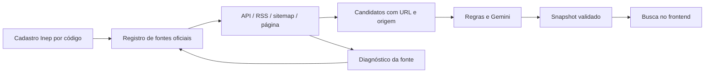

# Plano para tornar a busca funcional

Data: 16/11/2026. Este plano parte do código e da auditoria local, não de uma hipótese de que todas as instituições publicam os mesmos tipos de edital.

## Estado confirmado

- O diretório contém 317 instituições públicas do Censo da Educação Superior 2024. A busca de processos no frontend ainda apresenta seis links conhecidos e o feed da API consulta apenas UFPB, UFCG, UEPB e IFPB.
- A revisão de fontes identificou 163 sites institucionais que o coletor acessa por HTTPS, 57 APIs de busca WordPress, 62 feeds RSS e 66 sitemaps. Em 49 APIs, a busca por termos de ingresso encontrou títulos candidatos em 21 UFs. Um título candidato ainda não é um edital validado.
- Dos 43 sites antes classificados como inacessíveis, 25 passaram a responder após usar a loja de certificados do sistema, corrigir URLs oficiais e repetir a checagem. Permanecem 18: seis desafios antibot, três HTTP 403, um HTTP 500 e oito falhas locais de DNS ou conexão. A causa observada por instituição está em `frontend/data/inep/unreachable-site-cases.csv`.
- O cadastro nacional e o feed de links são independentes da publicação de `SelectionProcess` no banco legado. A API NestJS depende da infraestrutura local; o usuário já encontrou um ambiente sem `docker`. O worker legado ainda não entrega atualização nacional de documentos.

## O que significa “funcional” nesta versão

1. Uma pesquisa por instituição, UF e tipo de ingresso devolve páginas oficiais relevantes quando a fonte publica essas páginas. Cada resultado traz instituição, tipo, URL de origem e data da última checagem.
2. A interface distingue **página oficial de seleção**, **edital encontrado** e **inscrições abertas confirmadas**. A última condição só aparece quando as datas do edital foram extraídas e verificadas; caso contrário, mostra “prazo não confirmado”.
3. Uma falha temporária da fonte ou da IA conserva o último resultado válido e mostra quando ele foi atualizado. Uma busca sem correspondência exibe os sites institucionais disponíveis para continuar a pesquisa.
4. A primeira entrega funciona localmente com Node e o frontend, sem exigir Docker. PostgreSQL e Redis entram quando o catálogo persistente e as filas estiverem prontos.
5. Não há aprovação manual para publicar um **link oficial**. As regras automáticas exigem domínio oficial, título e categoria plausíveis, proveniência da descoberta e rejeição de resultados, pós-graduação e SiSU regular. Campos de vagas, prazos e requisitos só são publicados com evidência extraída da fonte.

## Ordem de execução

| Etapa                               | Entrega concreta                                                                                                                                                                                                                                                                    | Critério para concluir                                                                                                                                                                      | Esforço estimado            |
| ----------------------------------- | ----------------------------------------------------------------------------------------------------------------------------------------------------------------------------------------------------------------------------------------------------------------------------------- | ------------------------------------------------------------------------------------------------------------------------------------------------------------------------------------------- | --------------------------- |
| 0. Fazer a busca responder          | Gerador independente de um arquivo JSON de resultados, servido pelo frontend como fallback quando a API não estiver ativa; pesquisa local por instituição, UF, termo e categoria. Incluir os quatro portais existentes e um primeiro lote validado de APIs WordPress de outras UFs. | Testes de ponta a ponta para buscas conhecidas em pelo menos cinco UFs; links abrem a instituição correta; a tela mostra `checkedAt`; funciona sem Docker.                                  | 1–2 dias                    |
| 1. Expandir fontes oficiais         | Registro por código Inep com URL, tipo de conector (`wordpress`, `rss`, `sitemap`, `html`), domínios aceitos e estado de acesso. Adaptar o coletor para 15–20 instituições com candidatos relevantes, distribuídas entre as UFs já encontradas.                                     | Cada fonte tem última tentativa, última coleta bem-sucedida e motivo da falha. Uma falha não apaga resultados antigos. URLs fora do domínio confirmado são descartadas.                     | 2–3 dias                    |
| 2. Classificar e deduplicar         | Gemini recebe somente candidatos obtidos da fonte oficial e devolve IDs e categorias estruturadas. Regras determinísticas verificam URL, domínio, nível de graduação, tipo de ingresso e duplicatas. PDFs já descobertos podem fornecer texto e evidências.                         | Conjunto de exemplos positivos e negativos inclui transferência, graduados, vagas remanescentes, resultados, pós-graduação e SiSU regular. Nenhum URL criado pela IA chega à interface.     | 1–2 dias                    |
| 3. Automatizar a atualização        | Execução programada a cada 6–12 horas, limite por domínio, cache atômico, tentativas com espera progressiva e painel simples de estado por fonte. Publicar o snapshot somente após validação.                                                                                       | Resultados novos aparecem em até 24 horas após uma fonte acessível publicá-los; falhas ficam visíveis; o último snapshot válido continua disponível.                                        | 1–2 dias                    |
| 4. Fechar cobertura de instituições | Resolver os 131 registros sem correspondência no ROR e as cinco siglas ambíguas usando páginas institucionais e diretórios oficiais; revisar os 18 problemas de acesso restantes e buscar fontes alternativas da própria instituição.                                               | Os 317 registros têm estado explícito: portal de seleção, site institucional confirmado ou fonte ainda não localizada. Cobertura de resultados é medida separadamente por UF e instituição. | Trabalho contínuo por lotes |

As estimativas são esforço de implementação após o ambiente local estar pronto. A etapa 0 entrega valor antes de concluir o levantamento nacional de fontes.

## Fluxo técnico

O ROR ajuda a descobrir o site da instituição; não oferece editais de ingresso. O conector WordPress pode pesquisar termos no JSON público do site, mas precisa confirmar que o resultado é de graduação e pertence à instituição. RSS e sitemap podem revelar documentos novos. A IA classifica e extrai informações **de links já descobertos**, mantendo o texto ou PDF de origem como evidência. Para sites que exigem desafio antibot, o sistema conserva o link institucional e usa outro canal oficial disponível; não tenta contornar o bloqueio.

O [Grounding with Google Search](https://aistudio.google.com/docs/terms#grounding-with-google-search) do Gemini não será usado para construir o índice: os termos atuais proíbem coletar seus links para indexar ou escolher páginas para crawling. Uma API de busca de terceiros só entra após confirmação de que sua licença permite esse uso.

## Decisões de implementação

- **Identidade:** código Inep como chave da instituição. Sigla e nome servem à pesquisa e podem se repetir.
- **Resultado mínimo:** `institutionId`, `title`, `url`, `category`, `sourceUrl`, `discoveredAt`, `checkedAt`, `pageKind` e estado de verificação. Guardar hash do conteúdo para deduplicação e atualização.
- **Coleta:** HTTPS com validação TLS; no Windows, iniciar Node com `--use-system-ca`. Reconhecer redirecionamento para desafio antibot, HTTP 403/500, DNS e timeout como estados distintos. Usar as correções documentadas em `frontend/data/inep/official-website-corrections.json`.
- **Persistência rápida:** snapshot JSON gerado atomicamente, com versão de esquema e último snapshot bom. Quando a cobertura e o volume exigirem, migrar os mesmos campos para PostgreSQL. Redis fica para filas e limitação distribuída, sem bloquear a primeira entrega.
- **Interface:** a consulta de processos e o diretório de instituições mostram contagens próprias. Ao pesquisar um curso ou termo sem processo identificado, a interface informa isso e oferece o portal ou site oficial da instituição filtrada.
- **IA:** chave somente no backend ou no gerador local, nunca no bundle Angular. Limitar custo por fonte e registrar contagem de candidatos, decisões e falhas sem gravar a chave.

## Verificação antes de considerar a primeira entrega pronta

- Consultar ao vivo UEPB, UFCG e um conjunto de fontes WordPress de pelo menos cinco UFs; abrir amostras dos links e confirmar título, instituição, categoria e URL.
- Rodar testes de casos positivos e negativos, build, lint e uma navegação real em `/oportunidades` com e sem API.
- Confirmar que desligar a rede ou receber HTTP 403/500 não zera o catálogo já publicado.
- Conferir o relatório de fontes após uma execução agendada e registrar a data mais antiga entre os resultados exibidos.

O primeiro passo de código após este planejamento é refatorar `OfficialFeedService` em conectores reutilizáveis e uma CLI que gere o snapshot consumido pelo frontend. Isso elimina a dependência do banco para a busca inicial e permite ampliar a cobertura fonte por fonte.

## Execução em 16/11/2026

- Etapas 0–2: o frontend lê o snapshot nacional sem Docker; a API o combina com seu feed da Paraíba. A CLI consulta 91 fontes de 12 portais de seleção e de sites institucionais, aplica regras de URL, conteúdo e categoria, usa Gemini quando disponível e preserva resultados anteriores em falhas. O snapshot tem 248 links de 52 instituições nas 27 UFs. Isso representa cobertura geográfica inicial, não cobertura de processos de todas as 317 instituições.
- Etapa 3: a CLI aceita `--watch` com intervalo de seis horas; um workflow agendado no frontend atualiza o snapshot no GitHub após a publicação do código no ramo `main`. A chave do Gemini precisa estar configurada como segredo nesse repositório para uso no GitHub Actions. O arquivo `sources[]` registra tentativa, sucesso, método, volume e erro por fonte. A atualização local e os testes não dependem do agendamento remoto.
- Etapa 4: todos os 317 registros têm um estado explícito no diretório; 163 têm site institucional acessível confirmado e 12 têm portal de seleção indicado. Os demais permanecem com fonte pendente. A investigação dos 18 casos de acesso problemático está em `frontend/data/inep/unreachable-site-cases.csv`. Novas fontes oficiais podem ser adicionadas por instituição sem alterar o contrato do feed.

A primeira entrega de busca está operacional com links oficiais e prazos não confirmados. Ainda falta extrair e verificar datas e vagas de cada edital, resolver fontes pendentes e medir a latência real do agendamento remoto após a publicação do workflow. Essas condições não devem ser confundidas com inscrições abertas ou cobertura integral de editais.

## Verificação em 17/11/2026

- A [execução manual](https://github.com/oeduardodev/PROJETO-Ads-frontend/actions/runs/43982886722) e a [execução agendada](https://github.com/oeduardodev/PROJETO-Ads-frontend/actions/runs/44042325101) do GitHub Actions concluíram a atualização e publicaram novos snapshots. Após configurar o segredo `LLM_PROVIDER_KEY`, uma [nova execução manual](https://github.com/oeduardodev/PROJETO-Ads-frontend/actions/runs/44114912056) também concluiu e registrou 17 fontes com classificação confirmada pelo Gemini. A falha ou cota da IA continua usando regras determinísticas.
- O feed ampliado consulta 99 fontes, incluindo 20 portais de seleção verificados. A medição local registrou 279 links de 62 instituições nas 27 UFs; 3 fontes falharam nessa execução sem apagar os resultados já publicados. O item mais antigo foi checado em 17/11/2026 às 07:54 UTC. As contagens variam a cada coleta; `official-feed.json` é a referência atual.
- A interface mostra o estado de cada fonte. A atualização valida o snapshot antes de publicá-lo, limita consultas simultâneas por domínio e usa espera crescente para falhas HTTP transitórias. Os testes locais cobrem classificação, domínios, `robots.txt`, fallback, tela sem API e navegação real.
- A cobertura do diretório permanece 317/317 com estado explícito. A cobertura de links é 62/317 nesta medição; os demais registros continuam visíveis com o site institucional quando confirmado ou com estado de fonte pendente. Inscrições, vagas e requisitos não são afirmados sem evidência.

As etapas 0 a 4 do plano estão implementadas para o escopo da primeira versão. O crescimento da cobertura de processos e a extração de dados específicos de editais são trabalho contínuo por fonte, conforme a definição de escopo acima.
